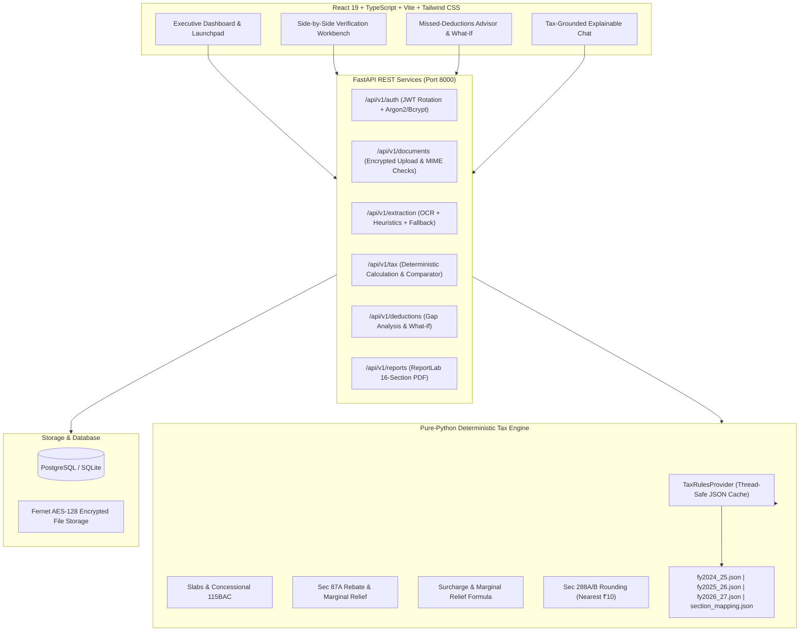

# INTELLIGENT TAX ASSISTANT
### Smart Tax Planning and Deduction Detection System

[](https://www.python.org/downloads/)
[](https://fastapi.tiangolo.com)
[](https://react.dev)
[](https://www.typescriptlang.org)
[](https://tailwindcss.com)
[]()

An explainable, production-ready fintech web application that ingests Indian financial documents (salary slips, Form 16, bank statements, investment proofs, insurance receipts, AIS/26AS), extracts and normalizes structured figures, categorises expenses, flags eligible and missed deductions, calculates tax under both the **Old** and **New** regimes, recommends the optimal regime, and exports audit-proof 16-section PDF reports.

> **Statutory Notice:** *Estimate only; not professional tax advice. Cross-check against statutory rules and official Income Tax Department records before filing.*

---

## 🏛️ Golden Rules

1. **Deterministic Tax Mathematics:** LLMs are **NEVER** permitted to calculate tax or evaluate eligibility. All tax mathematics is executed by a pure-Python rules engine (`decimal.Decimal` precision) strictly adhering to Section 288A/288B rounding to the nearest ₹10.
2. **Configurable Statutory Values:** Every slab, threshold, rebate formula, deduction limit, surcharge band, and cess rate lives in versioned, schema-validated JSON configurations (`backend/app/services/tax_engine/rules/`). **No tax constant is hardcoded.**
3. **Statutory Transition Support:** Complete dual support for both the **Income-tax Act, 1961** (FY 2024-25, FY 2025-26) and the **Income-tax Act, 2025** (FY 2026-27), with an auditable section crosswalk mapping legacy sections to new statutory sections.
4. **User Verification Before Calculation:** AI-extracted data is always surfaced on a side-by-side verification workbench with per-field confidence badges, source snippets, inline editing, and multi-document conflict resolution.
5. **Privacy First (DPDP Act 2023):** AES-128 Fernet encryption for files at rest and sensitive PII (PAN stored encrypted, masked in UI as `ABCDE****F`), strict user-isolated tenant boundaries (IDOR prevention), one-click full data export, and permanent account purge.
6. **Statutory Disclaimer Everywhere:** Every calculation screen, What-If simulator, chat response, and PDF report prominently displays statutory disclaimers.

---

## 📐 System Architecture



---

## 📦 Modules Implemented

- **M1: Auth & Profile:** JWT access/refresh rotation, PAN encrypted at rest and masked in UI, age brackets (Regular, Senior, Super Senior), metro residency for HRA, complete IDOR query isolation.
- **M2: Document Upload:** Drag-and-drop multi-file uploader (PDF, JPG, PNG, CSV, XLSX), MIME verification, 10MB limits, password-protected PDF modal, AES encrypted storage.
- **M3: AI Document Analysis:** Side-by-side preview workbench, OCR text extraction, confidence scoring, inline editing (`user_edited` flag), multi-document conflict resolution.
- **M4: Expense & Transaction Categorisation:** 20+ category classifier with scikit-learn offline fallback, tax-deductible expense detection, inline recategorisation with "apply to similar", split transaction modal (e.g. splitting loan EMI into 24(b) interest and 80C principal).
- **M5: Investment Analysis & 80C Optimisation:** Section 80C progress meter (up to ₹1.5L cap), 80CCD(1B) meter (₹50k cap), 80D meter (self/family + senior parents), Section 24(b) interest meter, actionable headroom recommendations.
- **M6: Deterministic Tax Engine:** FY 2024-25, FY 2025-26, and FY 2026-27 engines, Section 288A/B rounding, step-by-step audit trace, Advance tax schedule (15%, 45%, 75%, 100%), Section 234A/B/C interest calculations.
- **M7: Old vs New Regime Comparator:** Side-by-side line-by-line comparison, recommendation highlight with exact ₹ savings, binary-search break-even deduction point, built-in interactive Section 10(13A) HRA calculator.
- **M8: Missed-Deductions Advisor & What-If Simulator:** Flagship gap analyzer scanning parsed data against limits, interactive clarifying questionnaire (answers update profile live), live investment sliders calling the simulator in real-time.
- **M9: Form 16 / 26AS / AIS Reconciliation:** Cross-checks TDS deposited against claimed, detects shortfalls and unreported interest income, surfaces discrepancy severity badges.
- **M10: 16-Section Tax Summary Report:** Professional ReportLab PDF generation, report history, authenticated PDF downloads, report comparison engine.
- **M11: Tax Chat Assistant:** Tax-grounded explainable Q&A chat with statutory citations and suggested prompt pills.
- **M12: Guided Onboarding Wizard:** 13-step comprehensive onboarding stepper with save & resume capability.
- **M13: DPDP Compliance & Security:** Full JSON data export, permanent account deletion purge, and security audit log viewer.

---

## 🚀 Quickstart & Setup

### Prerequisites
- Python 3.11+ (Python 3.12 recommended)
- Node.js 20+ and npm
- (Optional) Docker and docker-compose

### 1. Clone & Setup Environment
```bash
cp .env.example .env
```

### 2. Backend Setup
```bash
cd backend
python -m venv .venv
# On Windows:
.venv\Scripts\activate
# On Linux/macOS:
source .venv/bin/activate

pip install -r requirements.txt
```

### 3. Generate Synthetic Documents & Seed Demo Account
Generates 8 sample synthetic PDFs and spreadsheets (salary slips, Form 16, insurance receipts, bank statements) and seeds default taxpayer account:
```bash
python scripts/seed_synthetic_data.py
```
> **Default Demo Login:**
> - Email: `demo.taxpayer@example.com`
> - Password: `Password123!`

### 4. Run Backend Server
```bash
python -m uvicorn app.main:app --host 0.0.0.0 --port 8000 --reload
```
API Swagger docs will be accessible at: `http://localhost:8000/docs`

### 5. Frontend Setup
```bash
cd ../frontend
npm install
npm run build
npm run dev
```
Open `http://localhost:5173` in your browser. Click **"Instant Demo Sign-In"** to log straight in!

---

## 🐳 Docker Deployment

To launch the complete application stack (React Frontend via Nginx, FastAPI Backend with Tesseract OCR, and PostgreSQL 16):

```bash
docker-compose up --build -d
```
- Frontend UI: `http://localhost`
- Backend API: `http://localhost:8000`
- API Documentation: `http://localhost:8000/docs`

---

## 🧪 Testing

### Backend Test Suite (Pytest)
Run the 25 unit, golden-case, and invariant tests:
```bash
$env:PYTHONPATH = "backend"
backend\.venv\Scripts\python.exe -m pytest backend/app/tests/ -v
```

**Test Coverage Highlights:**
- `test_tax_engine_golden.py`: 13 golden cases (7L, 12L, 12.75L, 12.8L marginal relief, 15L, 25L, 50L, 1.2Cr, Senior Citizen, HRA metro vs non-metro, full deductions).
- `test_tax_engine_properties.py`: 5 randomized property invariants (non-negativity, rebate monotonicity, 4% cess, Section 288A/B rounding).
- `test_auth_and_idor.py`: User registration, PAN encryption/masking, IDOR tenant isolation (User A cannot access User B data), and complete DPDP account purge.
- `test_extraction_pipeline.py`: OCR parsing of synthetic salary slips, Form 16, password-protected PDFs, and bank statement CSVs.

### Frontend TypeScript Compilation & Build
```bash
cd frontend
npm run build
```

---

## 📚 Documentation
- [System Architecture & DB Schema](docs/architecture.md)
- [REST API Contract Specification](docs/api.md)
- [Statutory Rules & Section Crosswalk Guide](docs/tax-rules-guide.md)

---

## 📄 License & Disclaimer
This software is provided for personal financial planning and educational purposes. **Estimate only; not professional tax advice.**
Complies with the provisions of the Digital Personal Data Protection Act, 2023 (DPDP).
